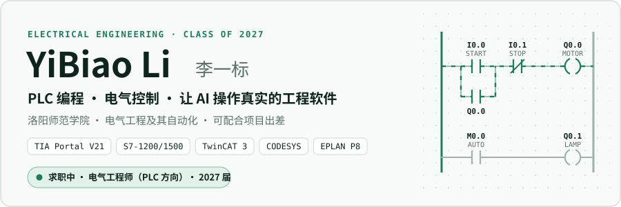
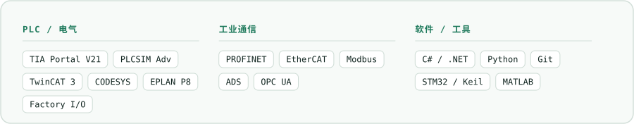

<!-- Assets are generated by scripts/build_assets.py (light + dark). Keep block-level HTML unindented. -->
<a href="https://biaobiao.space/"><picture><source media="(prefers-color-scheme: dark)" srcset="./assets/banner-dark.svg" /></picture></a>

<a href="https://biaobiao.space/"><picture><source media="(prefers-color-scheme: dark)" srcset="./assets/btn-website-dark.svg" /></picture></a>&nbsp;
<a href="https://github.com/search?q=is%3Apr+author%3Abiaobiao2233+-user%3Abiaobiao2233&type=pullrequests"><picture><source media="(prefers-color-scheme: dark)" srcset="./assets/btn-prs-dark.svg" /></picture></a>

### 精选项目

<a href="https://github.com/biaobiao2233/tia-guard"><picture><source media="(prefers-color-scheme: dark)" srcset="./assets/card-tia-guard-dark.svg" /></picture></a>

<a href="https://github.com/biaobiao2233/servo-motion-lab"><picture><source media="(prefers-color-scheme: dark)" srcset="./assets/card-servo-dark.svg" /></picture></a>

### 上游开源贡献

向西门子、倍福等工业自动化厂商的官方仓库提交修复与功能改进（状态实时同步）：

| 仓库 · PR | 内容 | 状态 |
| --- | --- | :---: |
| [Beckhoff / ADS #312](https://github.com/Beckhoff/ADS/pull/312) | 为不可达目标的初始连接增加可选超时，Linux / Windows 验证 |  |
| [Beckhoff / ADS #313](https://github.com/Beckhoff/ADS/pull/313) | 无 TwinCAT 环境下独立构建、打包 Debian 13 ADS 工具 |  |
| [PLC-lang / RuSTy #1941](https://github.com/PLC-lang/rusty/pull/1941) | ST 编译器诊断代码输出排序，已获维护者 Approve |  |
| [Siemens / S7 Webserver API #265](https://github.com/siemens/simatic-s7-webserver-api/pull/265) | 诊断缓冲区超过 50 条时的完整读取 |  |
| [Siemens / S7 Webserver API #266](https://github.com/siemens/simatic-s7-webserver-api/pull/266) | 读取 Syslog 全部保留事件 |  |
| [Siemens / TIA Openness 示例 #49](https://github.com/siemens/tia-portal-openness-code-snippets/pull/49) | 遍历设备组与未分组的 PLC 设备 |  |
| [Beckhoff / Tc3 EventLogger #2](https://github.com/Beckhoff/Tc3Eventlogger_Samples/pull/2) | 修复 ResultMessage 示例中缺失的事件类 |  |

### 工具与平台

<picture><source media="(prefers-color-scheme: dark)" srcset="./assets/skills-dark.svg" /></picture>

<b>其它：AI 工程工具</b>

- [coding-tools-mcp-workbench](https://github.com/biaobiao2233/coding-tools-mcp-workbench) — 面向个人开发机的 MCP 编程运行时
- [project-continuity](https://github.com/biaobiao2233/project-continuity) — 跨会话、跨 Agent 的项目连续性协议
- [everos-control-center](https://github.com/biaobiao2233/everos-control-center) — EverOS 记忆检索与同步的桌面控制台

